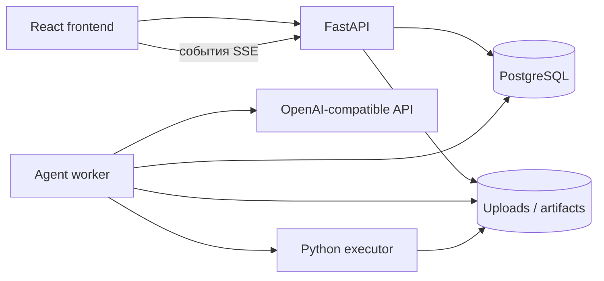

# Архитектура

DolphinLab разделён на интерфейс, HTTP API, агентный worker и сервис выполнения кода.
PostgreSQL хранит прикладное состояние и checkpoints сессий, файловые volumes — входы и артефакты.

## Backend

`dolphinlab.main` собирает приложение и подключает маршруты. `api/routes` содержит транспортный слой, `api/schemas` — контракты запросов, `api/presenters` — представления ответов.
Application-сервисы `ProjectService`, `RunService`, `MessageService`, `FileService` и `SettingsService` выполняют операции с проектами через переданную фабрику сессий.

`Worker` владеет общим планированием. `ProjectManager` обрабатывает переписку, `ResearchSession` готовит входы и исполняет один запуск. `ModelClientFactory` разделяет лимиты обращений между агентами и проверяет актуальность подключения.

`PlatformRuntime` связывает LangGraph и прикладное управление с исследовательским ядром.
`Runtime` координирует события; `TeamManager` управляет составом и жизненным циклом команд; `MemoryManager` — находками и общей памятью; `CandidateRegistry` — кандидатами, проверкой и публикацией.
`ResearchLedger` хранит научные основания решений, `Timing` — временные планы.

Инфраструктурные адаптеры реализуют PostgreSQL-хранилище, доступ к модели, резервирование расходов, шифрование ключей и связь с executor.
Интерфейс `ResearchStore` задаёт контракт хранения для ядра. `JobQueue` отвечает за очередь и неизменяемые копии исходников, `RemoteJobs` — за удалённое выполнение и сверку результата.

## Агенты и контекст

Роли задаются каталогом промптов. Техлид формирует команды и направления, тимлид распределяет работу, специалисты пишут код, evaluator проверяет результаты.
PM взаимодействует с пользователем и передаёт исследовательские поручения техлиду.

Каждая сессия проходит цикл `context → model → tools` в LangGraph. Рабочая память включает задачу, актуальные факты, роль, краткое резюме и последние обмены. Сжатие сохраняет связанные вызовы инструментов и использует отдельное обращение к модели; архивы остаются доступны через хранилище.
Квитанции инструментов и идентификаторы сообщений позволяют сверять прерванные действия.

## Frontend

`app` собирает пространство. Каталог `features` содержит проекты, настройки, исследования и чат PM. Общие UI-компоненты отделены от функциональных панелей.
`lib/api.ts` инкапсулирует HTTP-запросы. SSE обновляет состояние проекта при появлении событий.
Демонстрационные проекты находятся в `data` и отделены от данных сервера.

## Executor

Executor имеет собственные ML-зависимости и доступен только во внутренней сети Docker.
Supervisor следит за временем, памятью, процессами и журналами задания.
Код получает `TASK_ROOT` и `JOB_DIR`; учётные данные модели и базы ему не передаются.
Токен запуска и идентичность процесса используются для восстановления без слепого повторного обучения.

## Данные и жизненный цикл

Проект содержит входные файлы, настройки, переписку и несколько запусков. Каждый Run фиксирует задачу, версии входов, политику ресурсов и подключение модели.
Остановка и пауза проходят через управляющий канал. Архивация проекта сохраняет историю; удаление требует отсутствия активной работы.
Публикация результата требует независимой проверки кандидата.
